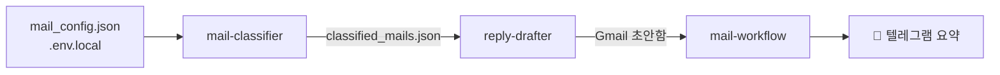
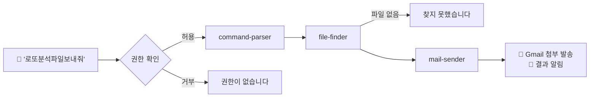
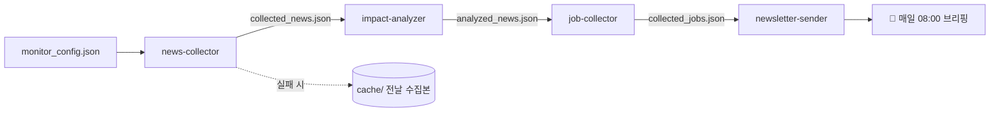
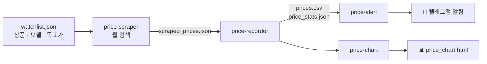
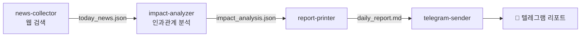
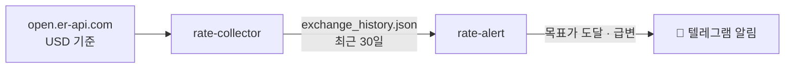
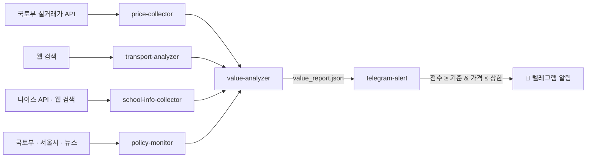

<div align="center">

# 🤖 MD_agents

**Claude Code로 만든 Markdown 기반 에이전트 · 워크플로우 실습 모음**

에이전트도, 워크플로우도, 작업 지침도 전부 `.md` 파일 하나로 정의합니다.


</div>

---

## 📚 목차

- [이 저장소는?](#-이-저장소는)
- [실습 목록](#-실습-목록)
- [폴더 구조 규칙](#-폴더-구조-규칙)
- [2.1 mail-agent](#-21-mail-agent--메일-분류--회신-초안)
- [2.2 file-sender](#-22-file-sender--텔레그램으로-파일-요청)
- [2.3 news-monitor](#-23-news-monitor--데일리-뉴스-브리핑)
- [3.1 price-tracker](#-31-price-tracker--최저가-추적--알림)
- [3.2 news-stock-analyzer](#-32-news-stock-analyzer--뉴스-기반-주식-영향-분석)
- [3.3 exchange-monitor](#-33-exchange-monitor--환율-모니터링--환전-타이밍-알림)
- [3.4 realestate-monitor](#-34-realestate-monitor--부동산-미래-가치-평가--알림)
- [보안 메모](#-보안-메모)

---

## 💡 이 저장소는?

각 실습 폴더의 **`CLAUDE.md`가 작업 지침서** 역할을 하고, 에이전트(`agents/*.md`)·워크플로우(`workflows/*.md`, `commands/*.md`)는
**YAML 프런트매터 + 본문** 형식의 Markdown으로 정의되어 있습니다.
판단이 필요한 일(분류·요약·검색)은 Claude가, 계산·발송처럼 정확해야 하는 일은 **Python 표준 라이브러리 스크립트**가 맡습니다.

## 🗂 실습 목록

| # | 폴더 | 한 줄 소개 | 핵심 산출물 |
|:-:|------|-----------|-------------|
| 1.1 | ✈️ [`family-travel-planner`](1.1-family-travel-planner) | 여행지·기간·예산·구성 → 일자별 코스, 숙소, 예산 검증, 최종 계획서 | `travel_plan.md`, `budget_summary.json` |
| 1.2 | 📅 [`schedule-assistant`](1.2-schedule-assistant) | 자연어 일정 → 충돌 확인 → Google Calendar 등록 · 초대 메일 | `agents/schedule-parser.md` 외 3개 |
| 2.1 | 📧 [`mail-agent`](2.1-mail-agent) | Gmail 미열람 메일 긴급/중요/일반 분류 + 회신 초안 + 텔레그램 요약 | `agents/mail-classifier.md`, `agents/reply-drafter.md` |
| 2.2 | 📎 [`file-sender`](2.2-file-sender) | 텔레그램 "기획서 보내줘" → PC에서 파일 찾아 Gmail 첨부 발송 | `commands/file-transfer.md`, `check_once.bat` |
| 2.3 | 📰 [`news-monitor`](2.3-news-monitor) | 키워드 뉴스 수집 → 영향도 분석 → 채용공고 → 매일 08:00 브리핑 | `workflows/news-workflow.md`, `newsletter_sender.py` |
| 3.1 | 🛒 [`price-tracker`](3.1-price-tracker) | 관심 상품 최저가 수집 → 이력 기록 → 목표가 알림 → 추이 차트 | `commands/price-track-workflow.md`, `price_chart.html` |
| 3.2 | 📈 [`news-stock-analyzer`](3.2-news-stock-analyzer) | 해외 핫이슈 뉴스 TOP 5 → 강세/약세 종목 분석 → 리포트 → 텔레그램 | `commands/news-stock-workflow.md`, `daily_report.md` |
| 3.3 | 💱 [`exchange-monitor`](3.3-exchange-monitor) | USD/JPY/EUR 원화 환율 매일 수집 → 목표가 도달·급변 시 텔레그램 환전 타이밍 알림 | `commands/exchange-workflow.md`, `rate_alert.py` |
| 3.4 | 🏠 [`realestate-monitor`](3.4-realestate-monitor) | 아파트 실거래 수집 → 교통·학군·정책 분석 → 100점 미래 가치 점수 → 조건 충족 시 텔레그램 알림 | `commands/property-monitor.md`, `value_analyzer.py` |

## 🧱 폴더 구조 규칙

```
<실습 폴더>/
├── CLAUDE.md            # 작업 지침서 (클로드 코드가 자동으로 읽음)
├── agents/*.md          # 에이전트 정의 (역할 · 입력 · 규칙 · 출력)
├── workflows/*.md       # 또는 commands/*.md — 에이전트를 묶은 워크플로우
├── *.py                 # 정확성이 필요한 단계 (표준 라이브러리만)
├── run_schedule.bat     # 작업 스케줄러용 무인 실행 (claude -p)
└── .env.example         # 필요한 환경변수 이름 (.env는 커밋 안 함)
```

---

## 📧 2.1 mail-agent — 메일 분류 · 회신 초안



- 분류는 키워드·발신자 규칙 + Claude 문맥 분석 중 **신뢰도 높은 쪽**을 채택합니다.
- 회신은 긴급=격식체 / 중요=정중체 / 일반=간략체로 쓰고, **자동 발송하지 않고 초안 저장까지만** 합니다.
- 텔레그램 전송: `scripts/send_telegram.ps1` (HTML · UTF-8, 1회 재시도, `-DryRun` 지원)

<details>
<summary><b>⚙️ 실행 준비</b></summary>

1. Claude Code에서 Gmail 커넥터를 연결합니다 (`/mcp`).
2. `2.1-mail-agent/.env.local`을 만듭니다.
   ```
   TELEGRAM_BOT_TOKEN=<BotFather에서 받은 토큰>
   TELEGRAM_CHAT_ID=<내 chat_id>
   ```
3. `mail_config.json`에서 `important_senders`, `urgent_keywords`, `check_interval` 등을 조정합니다.
4. Claude Code에서 `workflows/mail-workflow.md 워크플로우를 실행해줘`라고 요청합니다.

텔레그램 설정만 먼저 확인하려면:
```powershell
powershell -NoProfile -ExecutionPolicy Bypass -File scripts\send_telegram.ps1 -MessageFile tmp\msg.txt -DryRun
```
</details>

---

## 📎 2.2 file-sender — 텔레그램으로 파일 요청



- 슬래시 명령: `commands/file-transfer.md`(1건 처리), `commands/telegram-listener.md`(5초 간격 상시 대기)
- 실행: `check_once.bat`(새 메시지가 있을 때만 Claude 실행), `run_listener.bat`(상시 대기)
- 권한: bat은 `--permission-mode default` + `scripts/`의 스크립트 4개만 허용 (auto mode 오판 방지)
- 파일 검색은 `search_folders` 안에서만, 확장자·크기 필터 후 최신 1개 · SMTP_SSL(465) 발송

<details>
<summary><b>⚙️ 실행 준비</b></summary>

1. `sender_config.example.json`을 `sender_config.json`으로 복사하고 `search_folders`, `default_recipient` 등을 수정합니다.
2. `2.2-file-sender/.env`를 만듭니다. (Gmail은 2단계 인증 후 앱 비밀번호 발급)
   ```
   GMAIL_ADDRESS=<보내는 Gmail 주소>
   GMAIL_APP_PASSWORD=<앱 비밀번호 16자리>
   TELEGRAM_BOT_TOKEN=<BotFather에서 받은 토큰>
   TELEGRAM_CHAT_ID=<내 텔레그램 ID>
   ```
3. 무인 실행 시 `claude setup-token`으로 장기 토큰을 발급해 `CLAUDE_CODE_OAUTH_TOKEN` 사용자 환경 변수로 저장합니다.
4. `check_once.bat`을 작업 스케줄러에 등록하거나 `run_listener.bat`을 실행합니다.
</details>

---

## 📰 2.3 news-monitor — 데일리 뉴스 브리핑



| 단계 | 하는 일 |
|------|---------|
| news-collector | 최근 24시간, 키워드당 5건, 제목 유사도 80% 중복 제거 |
| impact-analyzer | 영향도 높음/보통/낮음 + 30자 요약 + 실무 시사점 (Claude) |
| job-collector | 사람인·원티드·링크드인·잡플래닛, 48시간·경력·지역·제외 키워드 필터 |
| newsletter-sender | MarkdownV2, 4000자 초과 시 분할, 실패 시 3분 후 1회 재시도 |

- 수동 실행: Claude Code에서 **`지금 브리핑 보내줘`**
- 자동 실행: `run_schedule.bat` — 1~3단계는 `claude -p`, 발송은 `python newsletter_sender.py` (`--dry-run` 지원)

<details>
<summary><b>⚙️ 실행 준비</b></summary>

1. `2.3-news-monitor/.env.example`을 `.env`로 복사하고 `TELEGRAM_BOT_TOKEN`, `TELEGRAM_CHAT_ID`를 채웁니다.
2. `monitor_config.json`에서 뉴스 키워드, 채용 키워드, 경력·지역 필터를 조정합니다.
3. 작업 스케줄러 등록 (PowerShell):
   ```powershell
   schtasks /create /tn NewsMonitorBriefing /tr '<폴더 경로>\run_schedule.bat' /sc daily /st 08:00 /f
   ```
</details>

---

## 🛒 3.1 price-tracker — 최저가 추적 · 알림



| 에이전트 | 실행 | 하는 일 |
|----------|------|---------|
| `price-scraper` | Claude (웹 검색) | 지정 **모델 · 다나와 페이지** 기준 국내 신품 최저가 조회. 중고·액세서리·해외직구·카드 조건부 할인 제외, 예상가 50~200% 이상치 검사 |
| `price-recorder` | `price_recorder.py` | `prices.csv` 누적(전일대비 변동, 중복 방지) + 역대 최저/최고/평균, 목표가까지 남은 금액, 7일 추세 |
| `price-alert` | `price_alert.py` | 목표가 달성 → `[최저가알림]`, 직전 대비 10%↓ → `[가격하락]` 텔레그램 발송 (`urllib`, `--dry-run`) |
| `price-chart` | `price_chart.py` | 요약 카드 + 상품별 선 그래프(목표가 빨간 점선, 최저가 ★) + 최근 변동 10건. **외부 라이브러리 없는 순수 HTML/CSS/JS(SVG)** |

- 실행: Claude Code에서 **`지금 가격확인해줘`** 또는 **`/price-track-workflow`**
- 자동 실행: `run_schedule.bat` — ①은 `claude -p`, ②~⑤는 Python 스크립트 (`--check`로 설정 점검)
- 완료 메시지: `수집완료 - [YYYY-MM-DD HH:MM] / 추적 중 상품 N개`
- 네이버 개발자센터 사용 API 목록에 검색 API가 없어(2026-11 기준), API 키 없이 **웹 검색 방식**으로 수집합니다.

> [!TIP]
> `watchlist.json`에는 상품마다 **정확한 `model`과 다나와 `url`**을 적어 두세요.
> 이름만 있으면("다이슨 에어랩") 수집 때마다 다른 라인업이 잡혀 이력이 섞이고 잘못된 알림이 갈 수 있습니다.

<details>
<summary><b>⚙️ 실행 준비</b></summary>

1. `3.1-price-tracker/.env.example`을 `.env`로 복사하고 `TELEGRAM_BOT_TOKEN`, `TELEGRAM_CHAT_ID`를 채웁니다.
2. `watchlist.json`에 상품(`name`, `model`, `url`, `expected_price`, `target_price`, `active`)을 등록합니다.
3. 알림 미리보기: `python price_alert.py --dry-run`
4. 작업 스케줄러 등록 (예: 매일 16:45):
   ```powershell
   schtasks /create /tn PriceTracker-Daily /tr '<폴더 경로>\run_schedule.bat' /sc daily /st 16:45 /f
   ```
</details>

---

## 📈 3.2 news-stock-analyzer — 뉴스 기반 주식 영향 분석



| 에이전트 | 실행 | 하는 일 |
|----------|------|---------|
| `news-collector` | Claude (웹 검색) | 해외(Reuters · Bloomberg · NBC · FT · WSJ) 우선, 국내(연합뉴스 · 한국경제) 보조로 지정학 · 경제정책 · 산업 · 기업 이슈 TOP 5 수집 |
| `impact-analyzer` | Claude | 뉴스별 강세 🔺 / 약세 🔻 종목 · 섹터(대표 3종목, 국내 우선), 이유, 영향 강도(높음/보통/낮음). **"뉴스 → 경제 변수 → 기업 영향" 인과 경로가 약하면 ➖ 중립** |
| `report-printer` | `report_printer.py` | 정해진 형식으로 콘솔 출력 + `daily_report.md` 저장, `logs/` 일별 백업(60일) |
| `telegram-sender` | `telegram_sender.py` | 리포트를 텔레그램 형식으로 변환해 발송 (`requests`, 4000자 초과 시 분할, 1회 재시도, `--dry-run`) |

- 실행: Claude Code에서 **`지금 뉴스 분석해줘`** 또는 **`/news-stock-workflow`**
- 자동 실행: `run_schedule.bat` — ①②는 `claude -p`, ③④는 Python 스크립트. `check_fresh.py`가 오늘 날짜로 갱신됐는지 확인하고, 아니면 **예전 결과를 발송하지 않고 중단** (`--check`로 설정 점검)
- 이 실습만 HTTP 호출에 **`requests`** 라이브러리를 씁니다 (책의 지시).

> [!WARNING]
> 모든 분석은 **참고용이며 투자 권유가 아닙니다.** 커밋된 `today_news.json`, `impact_analysis.json`, `daily_report.md`는 2026-11-12 공개 뉴스로 만든 예시 결과입니다.

<details>
<summary><b>⚙️ 실행 준비</b></summary>

1. `3.2-news-stock-analyzer/.env.example`을 `.env`로 복사하고 `TELEGRAM_BOT_TOKEN`, `TELEGRAM_CHAT_ID`를 채웁니다.
2. 발송 미리보기: `python telegram_sender.py --dry-run`
3. 작업 스케줄러 등록 (예: 평일 17:00):
   ```powershell
   schtasks /create /tn NewsStockAnalyzer-Evening /tr '<폴더 경로>\run_schedule.bat' /sc weekly /d MON,TUE,WED,THU,FRI /st 17:00 /f
   ```
</details>

---

## 💱 3.3 exchange-monitor — 환율 모니터링 · 환전 타이밍 알림



| 에이전트 | 실행 | 하는 일 |
|----------|------|---------|
| `rate-collector` | `rate_collector.py` | 무료 API(키 없음)에서 KRW·JPY·EUR 추출 → 달러/원, 100엔/원, 유로/원으로 변환. 같은 날은 덮어쓰고 최근 30일만 유지, 실패 시 1회 재시도 |
| `rate-alert` | `rate_alert.py` | 조건 ① 목표가 도달(`alert_below` 이하 / `alert_above` 이상) ② 전일 대비 `change_alert_pct`% 이상 급변 → 메시지 1개로 묶어 발송. 같은 통화·조건은 24시간 내 1회, 실패 시 1회 재시도, `--force`로 중복 방지 무시 |

- 실행: Claude Code에서 **`/exchange-workflow`** 또는 **`지금 바로 환율수집하고 알림조건을 확인해서 텔레그램 발송해줘.`**
- 자동 실행: `run_schedule.bat` (수집 → 알림 → `환율확인완료` 출력, `logs/schedule_run.log` 기록)
- 외부 라이브러리 없이 `urllib`만 사용합니다.

<details>
<summary><b>⚙️ 실행 준비</b></summary>

1. `.env.example`을 `.env`로, `exchange_config.example.json`을 `exchange_config.json`으로 복사하고 텔레그램 값과 목표 환율을 채웁니다.
2. 한 번 실행: `python rate_collector.py` → `python rate_alert.py`
3. 작업 스케줄러 등록 (매일 09:00):
   ```powershell
   schtasks /create /tn ExchangeMonitor-Daily /tr '<폴더 경로>\run_schedule.bat' /sc daily /st 09:00 /f
   ```
</details>

---

## 🏠 3.4 realestate-monitor — 부동산 미래 가치 평가 · 알림



| 에이전트 | 실행 | 하는 일 |
|----------|------|---------|
| `price-collector` | `price_collector.py` | data.go.kr 아파트 매매 실거래가 API로 관심 동의 최근 12개월 거래 수집(전용면적 필터), 단지별 최근 거래가 요약. 실패 시 1회 재시도 후 기존 데이터 유지 |
| `transport-analyzer` | Claude (웹 검색) | 지하철 연장·GTX·도로·버스·트램 호재를 착공완료/계획확정/검토중으로 판정 → 0~30점 |
| `school-info-collector` | Claude + 나이스 API | 주변 초·중·고 목록과 특목·자사고 진학률 → 0~20점 |
| `policy-monitor` | Claude (웹 검색) | 재건축·재개발·용도지역·규제완화·토지거래허가 → -10~+20점 |
| `value-analyzer` | `value_analyzer.py` | 같은 단지 12개월 평균(지역 상승률 보정) 대비 저렴한 정도 → 시세 0~30점, 합산 100점 + 참고 의견(적극매수/관망/보류) |
| `telegram-alert` | `telegram_alert.py` | 기준 점수 이상·예산 이하 매물 알림. 같은 매물은 7일에 1회, 면책 문구 필수, `--dry-run` 미리보기 |

- 실행: Claude Code에서 **`/property-monitor`** 또는 **`지금 매물 한번 분석해줘`**
- 자동 실행: `run_schedule.bat` (실거래 수집 → 분석 → 알림, 교통·학군·정책은 최근 결과 재사용, 90일 지난 로그 삭제)
- 매물 시세 API가 없어 **최근 실거래가를 매물가 대신** 사용합니다.
- 결과는 참고용이며 투자 판단은 본인 책임입니다.

<details>
<summary><b>⚙️ 실행 준비</b></summary>

1. data.go.kr에서 "국토교통부_아파트 매매 실거래가 자료" 활용신청, 나이스 교육정보 개방 포털에서 인증키 발급
2. `.env.example`을 `.env`로 복사하고 API 키와 텔레그램 값을 채웁니다.
3. `watch_config.json`에서 관심 지역·예산·면적·알림 기준 점수를 설정합니다.
4. 작업 스케줄러 등록 (매일 17:40):
   ```powershell
   schtasks /create /tn RealEstateMonitor-Daily /tr '<폴더 경로>\run_schedule.bat' /sc daily /st 17:40 /f
   ```
</details>

---

## 🔒 보안 메모

| 대상 | 처리 |
|------|------|
| `.env`, `.env.*` (토큰 · 키 · chat_id) | 루트 `.gitignore`로 제외 — `.env.example`만 커밋 |
| 2.1 `classified_mails.json`, `draft_replies.json`, `logs/` | 메일 제목·발신자가 담겨 제외 |
| 2.2 `sender_config.json`(개인 메일 주소), `logs/` | `2.2-file-sender/.gitignore`로 제외 |
| 2.3 `newsletter_log.json`, `logs/`, `cache/` | `2.3-news-monitor/.gitignore`로 제외 |
| 3.1 `alert_history.json`(텔레그램 발송 이력), `logs/` | `3.1-price-tracker/.gitignore`로 제외 |
| 3.2 `logs/`(텔레그램 발송 로그 · 스케줄 로그) | `3.2-news-stock-analyzer/.gitignore`로 제외 |
| 3.3 `exchange_config.json`(토큰), `exchange_history.json`, `alert_state.json`, `logs/` | `3.3-exchange-monitor/.gitignore`로 제외 — `exchange_config.example.json`만 커밋 |
| 3.4 `alert_state.json`(발송 이력), `price_data.json`, `value_report.json`, `logs/` | `3.4-realestate-monitor/.gitignore`로 제외 — `*_score.json`은 공개 자료 기반 예시 결과 |

커밋된 `collected_*.json`, `analyzed_news.json`, `scraped_prices.json`, `prices.csv`, `price_chart.html`은 공개 뉴스·채용공고·쇼핑 가격으로 만든 **예시 결과**입니다.
